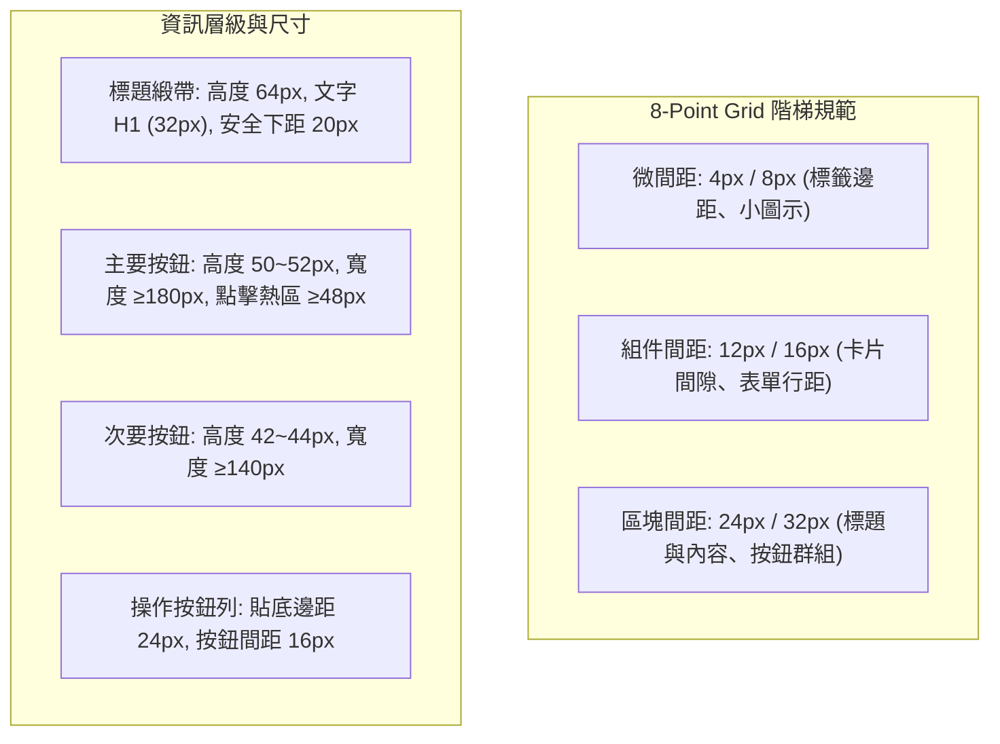

# 《落子無悔》V1.5.2 排版全面防禦方案（Round 1 審查意見書）

審查角色：V1.5.2 方案審查者（第 1 輪 / 共 3 輪）  
依據文件：[`coordination/v152-r0-draft.md`](file:///mnt/c/Users/timmy/projects/no-take-backs/coordination/v152-r0-draft.md)、[`docs/STATE.md`](file:///mnt/c/Users/timmy/projects/no-take-backs/docs/STATE.md)、[`game/tools/dev_main.gd`](file:///mnt/c/Users/timmy/projects/no-take-backs/game/tools/dev_main.gd)  
驗證原則：純讀檔分析、不更動數值與戰鬥模擬邏輯（保持戰鬥雜湊不變）。

---

## 一、補充初稿 §1 漏掉的排版問題清單

初稿僅列出 L1～L8 等 8 項問題，經全面比對原始碼與截圖，兩大低級錯誤的根因以及未被初稿捕捉到的重大排版缺陷補充如下：

### 1. 使用者指出之兩大低級錯誤根因剖析
* **主畫面第二層卡片面板未置中**：
  * **位置**：[`game_menus.gd:1195`](file:///mnt/c/Users/timmy/projects/no-take-backs/game/scripts/ui/screens/game_menus.gd#L1195)（`_draw_hub`）
  * **程式碼**：`var P := Rect2(430, clampf((800.0 - ph) * 0.5, 16.0, 120.0), 800, maxf(ph, 300.0))`
  * **根因**：面板 x=430、寬 800，幾何中心為 x=830（右偏畫面中線 640 達 **190px**！左留白 430px、右留白僅 50px）。且下方返回按鈕以 `P.get_center().x - 80` 定位，導致按鈕同步右偏至 750..910。原作者誤以為要避開左側木牌，但本畫面開頭已畫全螢幕遮罩 `draw_rect(Rect2(0, 0, 1280, 800), ...)`，本質為模態彈窗，面板**必須全局水平置中**（`x = 240, w = 800`）。
  * **建議規則**：全螢幕遮罩下的模態容器（Modal Container），`abs(rect.get_center().x - 640.0) <= 1.0`。
* **大廳分頁紅書籤未貼頂、懸空且位置偏移**：
  * **位置**：[`lobby_view.gd:1146-1153`](file:///mnt/c/Users/timmy/projects/no-take-backs/game/scripts/ui/lobby_view.gd#L1146-L1153)（`_draw_bookmark` 與分頁列）
  * **程式碼**：`bx := r.end.x - 34.0`, `by0 := r.end.y - 4.0`
  * **根因**：
    1. 書籤掛在分頁按鈕的最右側（`end.x - 34`），而非分頁標籤正下方居中或左緣對齊，破壞視覺重力軸。
    2. 分頁按鈕底邊為 `y = 96 + 68 = 164`，下方羊皮紙頂邊為 `top = 176 - 8 = 168`，中間有 4px 縫隙。書籤垂直跨距寫死 `by0 = 160` 至 `by1 = 172`，在 164～168 之間形成懸空穿幫。
    3. 自訂分頁細項（`_draw_lobby_detail`）甚至直接漏呼叫 `_draw_bookmark()`。
  * **建議規則**：依附型裝飾（Attached Ribbon/Bookmark）之頂部必須與父組件邊界貼齊（接縫誤差 `0px`），水平軸應鎖定父按鈕幾何中線。

---

### 2. 補充初稿漏列的系統性排版缺陷

#### 【缺陷 A】標題緞帶（`_h1`）下緣與內容過近甚至重疊（影響 8 個畫面）
* **問題機制**：[`ui_base.gd:715`](file:///mnt/c/Users/timmy/projects/no-take-backs/game/scripts/ui/ui_base.gd#L715) 中，`_h1` 標題緞帶底邊為 `center.y - 2 + tz("H1") * 1.45`（100% 字級為 `center.y + 44.4`；150% 下達 `center.y + 48.75`）。多個畫面將首行說明文字寫死在 `center.y + tz("H1") * 1.4` 或 `1.5`：
  1. [`game_place.gd:936`](file:///mnt/c/Users/timmy/projects/no-take-backs/game/scripts/ui/screens/game_place.gd#L936)（`_draw_plan_overlay`）：文字在 `182 + tz("H1") * 1.4`，文字與緞帶底邊間距僅 **0.4px**（150% 下僅 **0.25px**）。
  2. [`game_modes.gd:1296`](file:///mnt/c/Users/timmy/projects/no-take-backs/game/scripts/ui/screens/game_modes.gd#L1296)（`_draw_wager` 競猜）：間距 0.4px。
  3. [`game_modes.gd:418`](file:///mnt/c/Users/timmy/projects/no-take-backs/game/scripts/ui/screens/game_modes.gd#L418)（`_draw_relay` 接力賽）：間距 0.4px。
  4. [`game_modes.gd:1816`](file:///mnt/c/Users/timmy/projects/no-take-backs/game/scripts/ui/screens/game_modes.gd#L1816)（`_draw_ghosts` 幽靈賽）：間距 0.4px。
  5. [`game_modes.gd:1421`](file:///mnt/c/Users/timmy/projects/no-take-backs/game/scripts/ui/screens/game_modes.gd#L1421)（`_draw_draft` 輪抽）：間距 0.4px。
  6. [`game_menus.gd:943`](file:///mnt/c/Users/timmy/projects/no-take-backs/game/scripts/ui/screens/game_menus.gd#L943)（`_draw_restore` 還原存檔）：間距 3.6px。
  7. [`game_menus.gd:960`](file:///mnt/c/Users/timmy/projects/no-take-backs/game/scripts/ui/screens/game_menus.gd#L960)（`_draw_clear_data` 清除存檔）：間距 3.6px。
  8. [`game_modes.gd:1213`](file:///mnt/c/Users/timmy/projects/no-take-backs/game/scripts/ui/screens/game_modes.gd#L1213)（`_draw_nemeses` 宿敵戰記）：`y := 72.0 + tz("H1") * 1.6`，緞帶底邊達 126.4，卡片頂邊在 123.2，**緞帶直接壓在下方卡片上 3.2px**！
* **建議規則**：緞帶底邊至下方首個元件／文字的垂直安全距離（Safe Margin）必須 `≥ 16px`。

#### 【缺陷 B】固定高度面板導致留白極度過多（Empty State 缺陷）
* **位置與現象**：
  1. [`game_modes.gd:1215`](file:///mnt/c/Users/timmy/projects/no-take-backs/game/scripts/ui/screens/game_modes.gd#L1215)（`_draw_nemeses`）：面板寫死 `Rect2(190, 60, 900, 680)`。當玩家沒有宿敵記錄時，僅在 y=168 顯示一行無資料文字，距離 y=684 的返回鈕留白長達 **500px**！
  2. [`game_menus.gd:940`](file:///mnt/c/Users/timmy/projects/no-take-backs/game/scripts/ui/screens/game_menus.gd#L940)（`_draw_restore`）：無自動備份時，面板寫死高度 690，內容僅佔不到 15%，下方留白超過 400px。
  3. [`game_modes.gd:1025`](file:///mnt/c/Users/timmy/projects/no-take-backs/game/scripts/ui/screens/game_modes.gd#L1025)（`85_hint_locked.png`）：提示未解鎖面板寫死高度 500，內容在 y=380 結束，下方空置 270px。
* **建議規則**：面板應支援「內容適應收縮」（Hug Contents）或設定最小留白率限制（內容區域高度佔面板可用高度之比 `≥ 50%`，低於時應動態縮小面板）。

#### 【缺陷 C】確認彈窗（`_draw_confirm`）多行文字在 150% 字級下嚴重壓蓋按鈕
* **位置**：[`game_menus.gd:844-850`](file:///mnt/c/Users/timmy/projects/no-take-backs/game/scripts/ui/screens/game_menus.gd#L844-L850)
* **現象**：彈窗面板寫死 `Rect2(340, 250, 600, 300)`。當套用預設套裝（包含 6 條以上變更）且處於 150% 字級時，7 行文字垂直佔用達 252px，文字下緣抵達 y=542；然而操作按鈕固定在 y=478，**文字向下侵入並覆蓋按鈕達 64px**。
* **建議規則**：訊息彈窗高度必須為 `P_h = Header + TextHeight + Spacing + ButtonHeight + Padding` 之動態計算值。

#### 【缺陷 D】主畫面左側欄軸心錯位 20px
* **位置**：[`game_menus.gd:170-220`](file:///mnt/c/Users/timmy/projects/no-take-backs/game/scripts/ui/screens/game_menus.gd#L170-L220)（`_draw_title`）
* **現象**：左側「落子無悔」標題招牌與副標居中於 `x = 235`（左側欄 470px 的幾何中線）。但其下方的 5 塊主按鈕木牌與 3 顆小系統鈕配置在 `x = 70`、寬 `PW = 370`，其中心為 `70 + 185 = 255`。**標題軸線與按鈕列軸線存在 20px 的錯位**，造成視覺失衡。
* **建議規則**：同一欄位內的標題招牌與操作木牌，其水平幾何中線必須完全重合（偏差 `<= 1px`）。

#### 【缺陷 E】設定頁與對戰模式底部按鈕不對稱、中軸偏位
* **位置**：
  1. [`game_menus.gd:721-722`](file:///mnt/c/Users/timmy/projects/no-take-backs/game/scripts/ui/screens/game_menus.gd#L721-L722)（`_draw_settings`）：返回按鈕 `Rect2(560, 662, 160, 44)` 居中於 640，但「製作名單」按鈕塞在左側 `Rect2(380, 662, 160, 44)`，右側無對應按鈕，導致整個底部按鈕組的視覺中心在 550（左偏 90px）。
  2. [`game_modes.gd:1323-1324`](file:///mnt/c/Users/timmy/projects/no-take-backs/game/scripts/ui/screens/game_modes.gd#L1323-L1324)（`_draw_wager`）與 `1447-1448`（`_draw_draft`）：開打鈕寬 220（420..640），返回鈕寬 200（660..860），左右按鈕尺寸不對等。
* **建議規則**：底部雙按鈕組應寬度一致，且以畫面幾何中心 `x = 640` 對稱分佈（`GroupCenter.x == 640 ± 1`）。

---

## 二、評估 §2 偵測器設計（dev_main.gd）

### 1. 可行性評估（Feasibility）
* **探測結構擴充性高**：目前 [`ui_base.gd`](file:///mnt/c/Users/timmy/projects/no-take-backs/game/scripts/ui/ui_base.gd) 已有 `probe_texts`、`probe_btns`、`probe_boxes`，且 [`dev_main.gd:857`](file:///mnt/c/Users/timmy/projects/no-take-backs/game/tools/dev_main.gd#L857) 的 `_layout_report` 已具備文字截斷與對比度收集機制。
* **實現方式**：在 `_panel()`、`_h1()`、`_box()`、`_draw_bookmark()` 等基底函式注入 `probe_panels`、`probe_ribbons`、`probe_bookmarks`，並攜帶 `semantic_role`（例如 `#modal_panel`、`#ribbon_h1`、`#nav_tab`、`#bottom_actions`），即可在畫面繪製完成時執行幾何關係演算，**完全不需外掛外部工具**。

### 2. 誤報風險分析與豁免機制（False-Positive Analysis）
初稿設計的規則若直接硬編碼，將會引發大量誤報：
* **R1 全螢幕面板置中誤報**：
  * *風險*：大廳（`lobby_view.gd`）、設定（`_draw_settings`）、圖鑑等畫面採用「左側清單、右側詳細」的雙欄結構（如左欄寬 360、右欄寬 800），若單純檢查面板置中會全數誤報。
  * *解法*：僅對打上 `#modal` 或全螢幕遮罩層（`has_overlay`）下的頂層面板強制置中檢查（`Center.x == 640 ± 1`）。
* **R6 留白過多誤報**：
  * *風險*：空狀態（Empty State，如「暫無宿敵戰績」）文字面積本來就小，會直接觸發留白率低於 30% 報警。
  * *解法*：標記為 `#empty_state` 的畫面允許豁免，改為檢查「面板高度是否自適應縮小（`h <= 360`）」。
* **R4 按鈕列對稱誤報**：
  * *風險*：某些主要操作（如「開始遊戲」寬 240）與次要操作（如「返回」寬 160）刻意設計不同階梯。
  * *解法*：規則應定義為「整個按鈕群組的 Bound Box 中心必須在 640 ± 1」，而非強制每顆按鈕等寬。

### 3. 建議擴充的量測規則清單
| 代碼 | 規則名稱 | 量測演算法 | 閥值條件 |
| :--- | :--- | :--- | :--- |
| **R9** | **緞帶內容安全距** | 遍歷 `probe_ribbons` 與下方首個 `probe_texts`/`probe_boxes` | `y_content_top - ribbon.end.y >= 16px` |
| **R10** | **彈窗內容防溢出** | 彈窗內所有文字段與元件之 `max(end.y)` 與按鈕列 `min(rect.position.y)` 比較 | `button_top - text_bottom >= 12px` |
| **R11** | **依附裝飾接縫吻合** | `bookmark.rect.position.y` 與 `parent_tab.rect.end.y` | `abs(bookmark.top - parent.bottom) <= 1px` |
| **R12** | **主選單中軸一致性** | 比較標題看板 `Rect2` 與下方木牌組 `BoundingBox` 之 `get_center().x` | 偏差 `<= 1.0px` |

---

## 三、成熟遊戲 / UI 規範之具體數值建議

參考主機/PC 遊戲 UI 標準（如 10-foot UI / 8-point Grid System、Steam Deck 驗證規範），針對本專案 1280×800 基準解析度給出精確度量衡：

1. **模態彈窗（Modal / Confirm Dialog）幾何標準**：
   * 水平居中：嚴格鎖定 `Center.x = 640.0`。
   * 尺寸梯次：
     * 小型確認框（Confirm）：`W = 600px`，高度採內容動態計算（預設最小 `H = 260px`）。
     * 中型資訊框（Hub / Info）：`W = 800px`，動態居中 `x = 240px`。
     * 大型配置框（Settings / Presets）：`W = 1040px`，居中 `x = 120px`。
   * 留白率：內容區域佔面板高度比例應維持在 **60%～75%**；若內容未滿 50%，面板必須收縮（Hug Content）。
2. **標題緞帶（Ribbon `_h1`）與內容防撞**：
   * 緞帶下緣統一預留 **20px**（最低不得小於 16px）安全呼吸區，嚴禁以倍率乘法 `center.y + tz*1.4` 冒進排版。
3. **按鈕群組（Button Strip）**：
   * 底部按鈕統一高度：主按鈕 50px，次按鈕 44px。
   * 群組對稱：雙按鈕（確認/取消、開始/返回）寬度必須等寬（例如皆為 180px 或 200px），水平間隔 16px，整體幾何中線嚴格定於 640px。

---

## 四、工時估算與優先級排序（Roadmap）

總預估人時：**20～24 人時**。分為三個 Priority 階段執行：

| 優先級 | 項目與任務 | 具體內容 | 預估人時 |
| :---: | :--- | :--- | :---: |
| **P0** *(防禦基建)* | **1. 擴充檢驗器探針** [`game/tools/dev_main.gd`](file:///mnt/c/Users/timmy/projects/no-take-backs/game/tools/dev_main.gd) | • 在 `ui_base.gd` 補齊 `probe_panels`、`probe_ribbons` • 實作 R1(置中)、R4(群組對稱)、R9(緞帶安全距)、R10(彈窗防溢) • 輸出 JSON 結構化違規警告 | **5.0 h** |
| **P0** *(低級錯誤)* | **2. 修復使用者指出之錯誤** | • 修正 `game_menus.gd` 之 `_draw_hub` 面板與返回鈕居中（x: 430→240） • 修正 `lobby_view.gd` 之書籤水平居中與上下零接縫貼齊 | **1.5 h** |
| **P1** *(核心修正)* | **3. 修正標題緞帶壓字 (8處)** | 修正 `game_place.gd`、`game_modes.gd`（wager/relay/ghosts/draft/nemeses）等 8 處標題安全間距至 20px | **3.5 h** |
| **P1** *(核心修正)* | **4. 彈窗動態高度與對稱按鈕** | • 重構 `_draw_confirm` 支援多行文字與 150% 字級高度自動延展 • 修正設定頁底部按鈕群組左偏（加對稱佔位或居中調整） • 修正 Draft / Wager / Weekly 雙按鈕等寬與排序統一 | **4.0 h** |
| **P1** *(排版調優)* | **5. 主畫面中軸對齊與空狀態** | • 修正主畫面標題與木牌列 20px 偏心問題 • 宿敵、存檔還原空狀態面板自適應收縮高度 | **3.0 h** |
| **P2** *(驗證回歸)* | **6. 四語系與 150% 截圖回歸** | • 執行 `./game/tools/layout_check.sh` • 跑全量 19 組、2508 張截圖自動分析，達成 0 Layout Violation | **4.0 h** |
| **合計** | | **完整的偵測基建 + 程式碼修正 + 多語回歸驗證** | **21.0 h** |

---

### 審查結論摘要
初稿方案方向正確，但對低級錯誤的幾何根因挖得不夠深，且忽略了多達 8 個畫面的「緞帶壓字」與「動態 Confirm 框文字爆框」。建議將上述 **R9～R12 規則** 加入 §2 偵測器設計中，並以本報告的 **8-Point Grid 數值規範** 作為後續 R2/R3 實作與收斂之依據。
